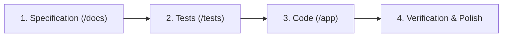

# AGENTS.md — OryxGate Contributor & Agent Guide

Welcome to **OryxGate**. This repository is an asynchronous API Gateway, state fusion engine, and caching microservice built for the virtual aviation operations stack (serving Qatar Airways Virtual / Oryxie Discord bot, WebApp Live Radar, and operations dashboards).

All AI coding assistants (Antigravity, Copilot, Claude, etc.) and human contributors working in this repository **must strictly adhere** to the principles, workflows, and standards documented below.

---

## 1. The Core Philosophy: Spec-Driven Development (SDD)

> **THE IRON LAW OF ORYXGATE:**
> **Documentation First $\rightarrow$ Tests Second $\rightarrow$ Implementation Third.**
> Never write implementation code without first having an approved specification in `/docs` and corresponding test cases in `/tests`.

Every feature, refactor, or new endpoint must progress through three discrete phases:



1. **Phase 1: Specification (`/docs/`)**:
   - Detail the business requirements, domain entities, HTTP/WS contracts, upstream API dependencies, error states, and caching TTLs.
   - Update the relevant document in `/docs/` (e.g. `api-spec.md`, `fleet-fusion-engine.md`, or a new feature RFC).
2. **Phase 2: Tests (`/tests/`)**:
   - Write unit and integration tests asserting the exact behavior detailed in the specification.
   - Mock upstream APIs (Infinite Flight v2/v3, Crew Center, MySQL) deterministically.
   - Tests **must fail** initially (red) or prove the absence of the feature.
3. **Phase 3: Implementation (`/app/`)**:
   - Implement the minimal, clean code required to satisfy the tests (green).
   - Adhere to the established repository layout and architectural patterns.
4. **Phase 4: Verification & Documentation Sync**:
   - Run the test suite and linters.
   - Ensure the docs reflect any nuance uncovered during implementation.

---

## 2. Project Architecture & Stack

- **Language / Runtime:** Python 3.11+
- **API Framework:** [FastAPI](https://fastapi.tiangolo.com/) (fully async with ASGI / `uvicorn`, default `ORJSONResponse`)
- **JSON Serialization & High-Throughput Deserialization:** [`orjson`](https://github.com/ijl/orjson) (vital for 1,500+ flight v2 payloads < 3ms)
- **Data Validation & Serialization:** [Pydantic v2](https://docs.pydantic.dev/latest/)
- **HTTP Client for Upstream APIs:** `aiohttp` or `httpx` (async connection pooling)
- **Database Access:** `aiomysql` (connection pooling with dictionary cursor) / SQLAlchemy async where appropriate
- **Caching Layer:**
  - In-memory async cache with TTL enforcement (default).
  - Pluggable Redis cache backend (future / scale-out).
- **Security & Auth:**
  - Token-based access (`Authorization: Bearer <GATEWAY_API_TOKEN>`).
  - Constant-time token verification (`secrets.compare_digest`).
  - Upstream pilot token delegation via `X-Pilot-ID` header.
  - Role-based permissions (read-only consumer vs. elevated VA staff actions).
- **Testing:** `pytest`, `pytest-asyncio`, `pytest-mock`, `respx` / `aioresponses`.

---

## 3. Directory Layout Standard

```
OryxGate/
├── AGENTS.md                       # This guide
├── README.md                       # Project overview and quickstart
├── pyproject.toml                  # Dependencies, build tooling, linters
├── docs/                           # Central Documentation & Specifications
│   ├── README.md                   # Documentation index
│   ├── architecture.md             # System architecture & gateway pattern
│   ├── spec-driven-development.md  # SDD manifesto and rules of engagement
│   ├── api-spec.md                 # REST endpoint contracts
│   ├── fleet-fusion-engine.md      # Live fleet state fusion & TOD heuristic
│   ├── upstream-integrations.md    # IF v2/v3, Crew Center, Database contracts
│   ├── verification-guide.md       # Simulator & live.infiniteflight verification
│   └── roadmap.md                  # Implementation roadmap & milestones
├── app/                            # Application Source Code
│   ├── __init__.py
│   ├── main.py                     # FastAPI app factory and lifecycle
│   ├── config.py                   # Environment settings (pydantic-settings)
│   ├── core/                       # Security, auth, logging, exceptions
│   ├── models/                     # Domain dataclasses & Pydantic schemas
│   ├── upstream/                   # Client wrappers for IF v2/v3, CC, MySQL
│   ├── services/                   # LiveFleetService, PIREPService, etc.
│   └── api/                        # FastAPI route handlers
│       └── v1/
├── tests/                          # Automated Test Suite (written before code)
│   ├── conftest.py                 # Shared fixtures, test settings, mock factories
│   ├── unit/                       # Unit tests for domain logic, fusion, scoring
│   ├── integration/                # Upstream wrapper integration tests
│   └── e2e/                        # End-to-end API route tests with TestClient
```

---

## 4. Key Engineering Constraints

### A. Upstream Rate Limit Compliance
Infinite Flight's Public APIs strictly penalize aggressive polling. OryxGate acts as a protective shield:
- **Never bypass caching unconditionally:** All external IF calls must route through the caching layer.
- **`force_refresh` Guardrails:** `force_refresh=true` is restricted strictly to tokens with `admin` scope AND throttled by a mandatory global 15-second debounce window. Unscoped requests ignore or reject this parameter.
- **Breadcrumb Batch Throttling:** When multiple flights are detected as stopped simultaneously, route breadcrumbs (`v2 /flight/{id}/route`) must be fetched with concurrency restricted via `asyncio.Semaphore(2)` to prevent 429 throttling.
- **Enforce Mandatory TTLs:**
  - Sessions: minimum **600s** (10 minutes).
  - Multiplayer Flight List: minimum **20s** ($\ge 15\text{s}$ upstream rule).
  - Flight Route Breadcrumbs: minimum **60s** ($\ge 15\text{s}$ upstream rule).
  - Organization Aircraft Roster: minimum **300s** (5 minutes).
  - Individual Telemetry / Positions: minimum **30s**.
  - Organization Schedules: minimum **60s**.

### B. Single Source of Truth for State Fusion & Stateless Boundary
- The logic that merges Infinite Flight v3 (persistent aircraft roster, schedule slots, claimed crew) with v2 (live multiplayer sessions, speed, breadcrumbs) and identifies **"Stopped at TOD / AP+ Hold"** belongs exclusively inside OryxGate. Downstream clients (Discord bots, WebApps) must never reimplement this heuristic.
- **Stateless Observer Boundary (Phases 1–4):** OryxGate acts as a pure, stateless telemetry gateway. It identifies stopped airframes, calculates duration, and yields last known pilot metadata. It does **not** manage Discord DM notification waves, escalation timers, or claim state transitions in MySQL `stopped_flights`; the Discord bot retains ownership of notification orchestration.
- **Null Island Filtering:** All telemetry and waypoint coordinates within $\pm 0.001^\circ$ of `(0.0, 0.0)` must be rejected as invalid simulator artifacts.

### C. Zero Unhandled Crashes on Upstream Outages
Infinite Flight and Crew Center APIs experience intermittent rate limits (`429`), gateway timeouts (`504`), and schema variations. OryxGate must:
- Gracefully serve stale cache when upstream is temporarily down.
- Implement exponential backoff with jitter on transient failures.
- Return standardized RFC 7807 problem details or clean structured error envelopes.

---

## 5. Agent Instructions for Common Tasks

### Task 1: Adding or Modifying an Endpoint
1. **Update Specs:** Edit `docs/api-spec.md` with path, request/response schema, authentication requirements, status codes, and example payloads.
2. **Write Tests:** Add test cases in `tests/e2e/test_<feature>.py` asserting valid 200 responses, 401 unauthorized cases, and 422 validation errors.
3. **Implement:** Add route handler in `app/api/v1/`, wire dependencies, and verify all tests pass.

### Task 2: Modifying Live Fleet Detection or Matching Heuristics
1. **Update Specs:** Document edge case in `docs/fleet-fusion-engine.md` (e.g. callsign token matching, corridor score calculation).
2. **Write Tests:** Add unit tests in `tests/unit/test_fleet_fusion.py` using synthetic aircraft and flight payloads representing the edge case.
3. **Implement:** Update `LiveFleetService` or matching utilities until tests turn green.

### Task 3: Upstream Client Modification
1. **Update Specs:** Ensure changes match `docs/upstream-integrations.md`.
2. **Write Tests:** Mock HTTP responses using `respx` or `aioresponses` in `tests/integration/test_<client>.py`.
3. **Implement:** Update client in `app/upstream/`.

---

## 6. Definition of Done (DoD)

A pull request or task is complete only when:
- [ ] Specification in `/docs/` is updated or created.
- [ ] Unit and integration tests cover happy paths, error paths, and edge cases.
- [ ] All tests pass cleanly (`pytest`).
- [ ] Linters and type checkers pass (`ruff`, `mypy`).
- [ ] No secrets or environment-specific credentials are hardcoded.
- [ ] API documentation (FastAPI Swagger `/docs` and markdown `/docs`) is in complete sync.
