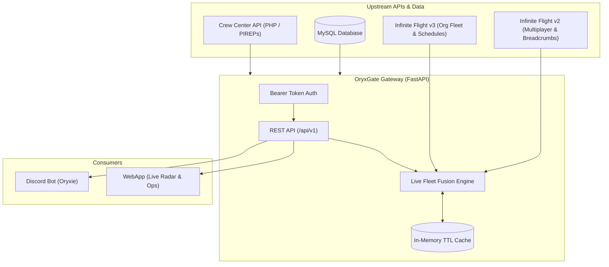

# OryxGate ✈️🌐

> High-performance API Gateway, State Fusion Engine, and Caching Microservice for Infinite Flight Virtual Aviation Operations.

---

## 📖 Overview

**OryxGate** is a centralized backend service built in **FastAPI** that acts as the single source of truth for Virtual Airline (VA) operations. It wraps external aviation APIs (Infinite Flight Live v2 & v3, Crew Center PHP API, and MySQL) and serves downstream clients (such as the **Oryxie Discord bot** and real-time **WebApps / Live Radars**).

### Key Capabilities
- **Live Fleet State Fusion:** Merges persistent organization airframes (v3) with real-time multiplayer telemetry (v2) and detects airborne stopped / AP+ holding flights at Top of Descent (TOD).
- **Rate Limit Shielding:** Enforces strict TTL caching compliant with Infinite Flight's usage policies, serving cached requests in **$< 5\text{ms}$** while preventing upstream bans.
- **Token-Based Gateway Security:** Authenticates all incoming consumer requests using Bearer API tokens.
- **Unified Wrappers:** Standardizes PIREP submissions to Crew Center and pilot verification lookups into clean REST endpoints.

---

## 🏛️ System Architecture



---

## 🛠️ Quickstart & Local Setup

### Prerequisites
- Python `3.11+`
- `pip` or virtual environment manager

### Setup Virtual Environment & Install Dependencies
```bash
# Create virtual environment
python -m venv .venv

# Activate virtual environment
# Windows (PowerShell):
.\.venv\Scripts\Activate.ps1
# Linux / macOS:
source .venv/bin/activate

# Install OryxGate in editable mode with development dependencies
pip install -e ".[dev]"
```

### Running Tests, Linter, and Type Checker
```bash
# Run pytest test suite
pytest

# Run ruff linter and formatter check
ruff check .
ruff format --check .

# Run mypy static type analysis
mypy
```

---

## 📜 Development Paradigm: Spec-Driven Development (SDD)

This repository strictly practices **Spec-Driven Development**:
1. **Documentation First (`/docs`):** Every endpoint, heuristic, and schema is defined in technical specifications first.
2. **Tests Second (`/tests`):** Automated unit, integration, and E2E test suites are authored to verify the specification (TDD).
3. **Implementation Third (`/app`):** Minimal, robust code is implemented to turn tests green.

👉 Read the [**Spec-Driven Development Guide**](file:///c:/Users/bum90/Bumy/Coding/OryxGate/docs/spec-driven-development.md) and [**AGENTS.md**](file:///c:/Users/bum90/Bumy/Coding/OryxGate/AGENTS.md) before contributing.

---

## 📚 Documentation Index

All technical specifications are stored in the [`/docs`](file:///c:/Users/bum90/Bumy/Coding/OryxGate/docs/README.md) directory:

- [**AGENTS.md**](file:///c:/Users/bum90/Bumy/Coding/OryxGate/AGENTS.md) — Contributor & AI Agent Instructions
- [**System Architecture**](file:///c:/Users/bum90/Bumy/Coding/OryxGate/docs/architecture.md) — Architectural overview, topology, and caching strategy
- [**API Specification (v1)**](file:///c:/Users/bum90/Bumy/Coding/OryxGate/docs/api-spec.md) — REST endpoint contracts, Bearer token auth, request/response models
- [**Fleet Fusion Engine**](file:///c:/Users/bum90/Bumy/Coding/OryxGate/docs/fleet-fusion-engine.md) — Live fleet fusion, TOD hold heuristics, and matching math
- [**Upstream Integrations**](file:///c:/Users/bum90/Bumy/Coding/OryxGate/docs/upstream-integrations.md) — Infinite Flight v2/v3, Crew Center, and MySQL contracts
- [**Live Data Verification**](file:///c:/Users/bum90/Bumy/Coding/OryxGate/docs/verification-guide.md) — Simulator & live.infiniteflight.com verification protocols
- [**Implementation Roadmap**](file:///c:/Users/bum90/Bumy/Coding/OryxGate/docs/roadmap.md) — Phased milestones from scaffolding to production
- [**Tasks & Sprints Plan**](file:///c:/Users/bum90/Bumy/Coding/OryxGate/docs/tasks-and-sprints.md) — Granular tasks, dependency graph, and acceptance criteria
