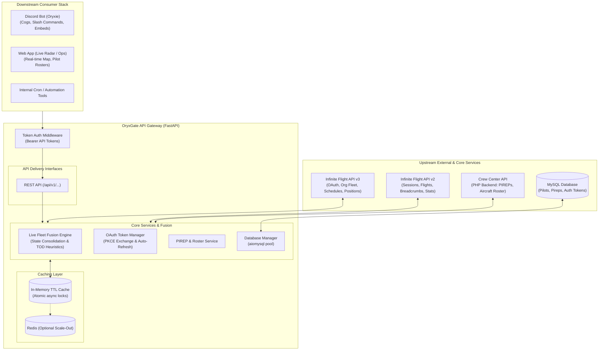

# OryxGate System Architecture

## 1. Executive Summary

**OryxGate** is an asynchronous API Gateway, state fusion engine, and caching microservice. It sits between external aviation APIs (Infinite Flight Live v2 & v3, Crew Center PHP API, MySQL database) and consumer applications (the Oryxie Discord Bot, future Live Radar WebApps, and operations dashboards).

Its primary responsibilities are:
1. **State Fusion:** Merging fragmented data from Infinite Flight v2 (multiplayer positions) and v3 (organization roster, schedules) into a single, canonical fleet representation.
2. **Rate Limit Shielding & Caching:** Serving downstream clients in `< 5ms` from in-memory cache while strictly adhering to upstream polling limits.
3. **Unified Access & Security:** Enforcing token-based authentication across all downstream requests and managing upstream OAuth2 tokens securely.

---

## 2. High-Level Architecture Topology

---

## 3. Core Subsystems

### A. Authentication & Security Middleware
- **Service-to-Service REST Requests:** Every incoming REST request from server-side clients (e.g. Oryxie Bot, WebApp backend, automated cron jobs) must include an `Authorization: Bearer <GATEWAY_API_TOKEN>` header, validated using constant-time comparison (`secrets.compare_digest`).
- **Configurable Access Tokens:** Support distinct consumer identities (e.g., `ORYXIE_BOT_TOKEN`, `WEBAPP_TOKEN`, `ADMIN_TOKEN`) with scope controls (`read`, `write`, `admin`).
- **Web App Architecture:** The browser frontend queries its own application backend (or reverse proxy), which communicates server-to-server with OryxGate using its dedicated gateway token. Gateway tokens are never distributed to client browsers.

### B. Live Fleet State Fusion Engine
The heart of OryxGate. Infinite Flight does not expose a single fleet endpoint; instead:
- **v3 Roster & Positions:** Provides aircraft registration, priority, rank, persistent ground/air state, and assigned schedules. However, position coordinates can lag and "stopped" states are frequently misreported as active cruise.
- **v2 Live Multiplayer:** Provides true real-time multiplayer telemetry (lat, lon, ground speed, track, altitude, session) and breadcrumb trails. It has no awareness of organization rosters.
- **High-Throughput JSON Parsing:** Uses `orjson` to parse v2 multiplayer payloads (1,500+ flights) in `< 3ms` instead of ~40ms with standard Python `json`.
- **Null Island Filtering:** Explicitly filters out all coordinates within $\pm 0.001^\circ$ of `(0.0, 0.0)` during flight plan parsing and corridor scoring to eliminate corrupted telemetry artifacts.
- **The Fusion Engine:** Matches v2 active flights to v3 organization airframes using a multi-pass heuristic (callsign token extraction, airline IATA/ICAO translation, crew pilot user ID, and route corridor projection).
- **Incident Detection:** Identifies aircraft stopped in the air (e.g., AP+ holding at Top of Descent / TOD or paused) and calculates stopped duration and last known pilot.
- **Stateless Observer Boundary (Phases 1–4):** OryxGate operates as a pure, stateless telemetry gateway. It identifies stopped aircraft and calculates duration/TOD status. It leaves Discord DM notification waves, escalation timers, and claim state transitions in MySQL `stopped_flights` to the Discord bot.

### C. Caching Layer & Rate Limit Shielding
Infinite Flight enforces strict polling minimums. OryxGate guarantees compliance by enforcing in-memory TTLs:

| Upstream Resource | Minimum Upstream Rule | OryxGate Cache TTL | Stored Data |
| :--- | :--- | :--- | :--- |
| **Sessions** | 10 minutes | **600 seconds** (10m) | Active multiplayer server session IDs |
| **Multiplayer Flights** | $\ge 15$ seconds | **20 seconds** | All active flights across sessions |
| **Flight Route Breadcrumbs**| $\ge 15$ seconds | **60 seconds** | Historical breadcrumb points for a flight |
| **Aircraft Roster** | 5 minutes | **300 seconds** (5m) | Complete organization airframe inventory |
| **Aircraft Positions (v3)**| 30 seconds | **30 seconds** | Persistence telemetry and last pilot info |
| **Organization Schedules** | Recommended 60s | **60 seconds** | Open and booked schedules list |
| **Organization Members** | Recommended 15m | **900 seconds** (15m)| Roster members for pilot matching |

- **Locking & Thundering Herd Prevention:** If expired, an `asyncio.Lock` ensures that only **one single upstream refetch** occurs, while other incoming requests await the fresh snapshot.
- **`force_refresh` Guardrails:** Forced cache bypass via `force_refresh=true` is only honored for tokens with `admin` scope and is protected by a global **15-second debounce** window. Non-admin calls or requests within the debounce window receive the cached snapshot.
- **Breadcrumb Batch Throttling:** When multiple aircraft are detected as stopped at the same time, queries to `v2 /flight/{id}/route` are bounded by an `asyncio.Semaphore(2)` to prevent sudden bursts and 429 throttling.

### D. Upstream Client Abstractions & Centralized OAuth Management
- **`IFLiveClient` (v3):** High-level client handling Bearer auth, automatic 429 rate limit backoff (reading `retry-after` / regex seconds), pagination, and domain dataclasses.
- **Centralized Master OAuth Token (`live_if_oauth_tokens`):**
  Infinite Flight v3 operations do not require multi-tenant pilot token delegation. Instead, the organization owner account (`pilot_id = 1` in `live_if_oauth_tokens`) possesses full administrative permissions (Organization Owner/Admin role) across the entire fleet.
  - This single master token has maximum scopes (`openid profile offline_access live:organizations.read live:aircraft.read live:schedules.read live:schedules.write`), granting full authority to read fleet telemetry, create/reorder/delete schedules, assign/remove crew, and file flight plans.
  - OryxGate's `TokenManager` monitors this master token in `live_if_oauth_tokens`. Whenever `expires_at < utcnow() + 60s`, it automatically invokes the OAuth2 `refresh_token` flow against Infinite Flight Auth v2, updates MySQL, and ensures 24/7 uninterrupted gateway operations without manual re-authorization.
  - Downstream consumers (Discord bot, WebApp) never deal with IF OAuth tokens—they simply call OryxGate using their standard Gateway Bearer token.
- **`InfiniteFlightAPIManager` (v2):** Async wrapper for public v2 endpoints with auto-reconnecting HTTP sessions and fast `orjson` deserialization.
- **`CrewCenterAPIManager`:** Submits PIREPs and resolves aircraft models to database IDs.
- **`DatabaseManager`:** Manages an `aiomysql` connection pool with automatic retry on operational disconnections.

---

## 4. Reliability & Fault Tolerance

1. **Stale Cache Serving (Graceful Degradation):**
   If Infinite Flight v2 or v3 returns `500 Internal Server Error`, `504 Gateway Timeout`, or network disconnects, OryxGate will log a warning and return the most recent cached snapshot with `cache_status: "stale"` rather than failing downstream requests.
2. **Self-Healing Sessions:**
   Both HTTP client sessions and MySQL connection pools include automated reconnection and retry loops to survive transient network drops.
3. **Structured Error Logging:**
   All unhandled exceptions are caught by global FastAPI exception handlers and mapped to standard error JSON payloads with trace IDs.
