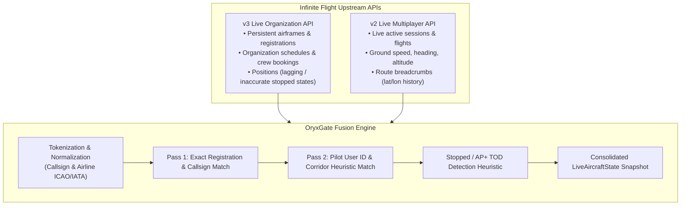
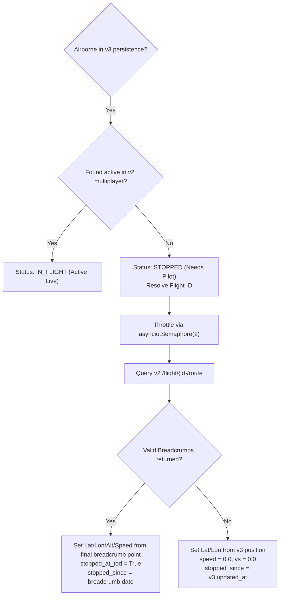

# Live Fleet State Fusion Engine Specification

## 1. Overview & Problem Statement

Infinite Flight does not offer a single API providing the real-time operational status of a Virtual Airline's fleet. Instead, data is split across two fundamentally disconnected APIs:

### The Upstream Flaws That Require Fusion
1. **Misreported Stopped State in v3:**
   When a flight is paused or reaches Top of Descent (TOD) and holds on AP+, the v3 persistence API typically continues reporting `state: 2 (IN_FLIGHT)` and retains its last high cruising speed.
2. **Missing Organization Context in v2:**
   The v2 API reports raw multiplayer flights across servers, but has zero knowledge of which flight belongs to which VA airframe or booking.
3. **Pilot Behavior Variations:**
   Pilots often fly VA aircraft using different callsigns (e.g. flying an airframe registered `A7-BCB` with flight callsign `QR843` or an IFC display callsign).

---

## 2. Callsign Normalization & Tokenization

To robustly match flights across systems, callsigns and registrations are parsed into normalized token sets using `clean_callsign_tokens()`:

### Step 1: Strip Suffixes
The following suffixes are stripped:
`HISTORIC`, `CARGO`, `CHARTER`, `VIP`, `FERRY`, `TRAINING`, `TEST`, `OPERATED`, `BY`.

### Step 2: Remove Hyphens & Whitespace
- `A7-BCB` $\rightarrow$ `A7BCB`
- `QR 843` $\rightarrow$ `QR843`
- `QR 843 HISTORIC` $\rightarrow$ `QR843`

### Step 3: Airline Code Expansion (IATA $\leftrightarrow$ ICAO)
Airline designators are bidirectional:
- `QR` $\leftrightarrow$ `QTR`
- `BA` $\leftrightarrow$ `BAW`
- `EK` $\leftrightarrow$ `UAE`
- `EY` $\leftrightarrow$ `ETD`
- `LH` $\leftrightarrow$ `DLH`
- `AF` $\leftrightarrow$ `AFR`

*Example:* A schedule with callsign `QR843` generates tokens `{"QR843", "QTR843"}`. A multiplayer flight with `QTR843` will cleanly match.

---

## 3. Multi-Pass Flight Association Algorithm

The engine associates active v2 flights with v3 organization aircraft using a deterministic two-pass algorithm. Each v2 flight can only be claimed once (`claimed_v2_flight_ids`).

### Pass 1: Direct Registration & Schedule Callsign Matches
For each organization airframe:
1. **Airframe Registration Match:**
   Extract registration tokens (e.g. `A7-APC` $\rightarrow$ `{"A7APC"}`).
   If a v2 candidate's callsign matches, and the pilot matches the airframe's crew or known organization members, claim the flight.
2. **Schedule Callsign Match:**
   If the aircraft has active scheduled flights, extract schedule callsign tokens.
   If candidate callsign matches, and candidate pilot is assigned crew (or a known org member), claim the flight.

### Pass 2: Pilot User ID & Heuristic Scoring
For pilots flying without a matching callsign (e.g. personal callsign):
Each unclaimed v2 flight associated with a known organization pilot is scored against all candidate airframes:

| Heuristic Factor | Condition | Score Delta |
| :--- | :--- | :--- |
| **Base Pilot Match** | Pilot ID matches aircraft assigned crew or last pilot | $+20$ |
| **Aircraft Model Match** | Content Aircraft / Livery ID matches | $+150$ |
| **Aircraft Model Mismatch**| Content Aircraft / Livery ID contradicts candidate | $-150$ |
| **Airborne Phase Match** | Both candidate flight and airframe are airborne | $+100$ |
| **Ground Phase Contradiction**| Cruising candidate flight matched to parked ground airframe | $-150$ |
| **Schedule In-Flight** | Active schedule status is `IN_FLIGHT` | $+100$ |
| **Schedule Callsign Token**| Callsign token intersection with any schedule | $+200$ |
| **Route Corridor Alignment**| Position within 8% excess of great-circle distance (origin $\rightarrow$ dest) | $+200$ |
| **Route Corridor Reasonable**| Position within 15% excess of great-circle distance | $+100$ |
| **Route Corridor Severe** | Position $> 500\text{ NM}$ off scheduled corridor | $-250$ |
| **Heading Alignment** | Heading within $45^\circ$ of destination bearing while enroute | $+100$ |

The airframe with the highest score $> 0$ wins the flight.

---

## 4. Null Island `(0.0, 0.0)` Coordinate Filtering

Infinite Flight simulator APIs occasionally report corrupt coordinates at `(0.0, 0.0)` ("Null Island") when GPS sync is lost, during initial session handshakes, or in uninitialized flight plan waypoints.
- **Rule:** Any coordinate pair where `abs(lat) < 0.001` and `abs(lon) < 0.001` must be immediately rejected during:
  - Active telemetry ingestion
  - Flight plan route extraction
  - Great circle distance and route corridor scoring
- If a flight's current position is Null Island, the engine falls back to the previous valid position or flags the position as invalid rather than calculating distances against the Gulf of Guinea.

---

## 5. Stopped Aircraft & AP+ TOD Detection Heuristic

When an aircraft is airborne according to v3 persistence (`state == IN_FLIGHT` or `is_on_ground == False`), but **no active multiplayer flight is found in v2**:

### Breadcrumb Batch Throttling (`asyncio.Semaphore(2)`)
If multiple aircraft pause or reach TOD simultaneously (e.g. after a group flight), querying all their breadcrumb routes concurrently risks exceeding Infinite Flight's strict public rate limits.
- **Concurrency Limit:** All breadcrumb calls during stopped aircraft evaluation must execute through an `asyncio.Semaphore(2)`.
- **Cache TTL:** Breadcrumb route points are cached for **60 seconds**, ensuring repeated monitoring cycles do not refetch unchanged trails.

### Why Breadcrumbs Matter for TOD Holding
When a pilot leaves Infinite Flight or AP+ holds at Top of Descent, the multiplayer connection drops. The last point recorded in the v2 route breadcrumb represents the **exact coordinates where AP+ engaged the hold**.
- OryxGate pulls the final non-zero breadcrumb point.
- Stores `stopped_at_tod = True`.
- Calculates `stopped_duration = utcnow() - stopped_since`.
- Exposes `stopped_display_time` (e.g. `"1.5h ago"`).

---

## 6. Architectural Boundary: Stateless Observer vs. Stateful Incident Manager

It is vital to draw a clean boundary between OryxGate and the Oryxie Discord bot:

| Responsibility | Handled By (Phases 1–4) | Future / Long-Term |
| :--- | :--- | :--- |
| **Telemetry Fusion & TOD Detection** | **OryxGate** | OryxGate |
| **Duration & Stopped Timestamp Calculation** | **OryxGate** | OryxGate |
| **Incident Escalation Timers & DM Waves** | **Oryxie Discord Bot** | Oryxie Discord Bot |
| **`stopped_flights` MySQL Claim State Machine** | **Oryxie Discord Bot** | OryxGate (Phase 6/7) |
| **Live Radar Map Visual Rendering** | **WebApp Frontend** | WebApp Frontend |

**Design Rule:** For Phases 1–4, OryxGate is a **Stateless Observer**. It answers *"What is the exact physical state of the fleet right now?"* without maintaining stateful notification wave timers or claiming workflows. This ensures OryxGate remains ultra-fast, robust, and cleanly decoupled.
