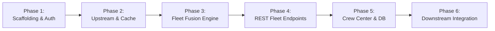

# OryxGate Implementation Roadmap

This document outlines the phased delivery roadmap for **OryxGate**. In accordance with Spec-Driven Development, each phase requires comprehensive test suites before implementation code is finalized.

---

## Milestone Overview

---

## Phase 1: Scaffolding, Configuration, & Token Auth

**Objective:** Establish the FastAPI application skeleton, environment management, and token authentication middleware.

- [x] Create `pyproject.toml` and lock dependencies (`fastapi`, `uvicorn`, `orjson`, `pydantic-settings`, `aiohttp`, `aiomysql`, `pytest`, `pytest-asyncio`, `respx`).
- [x] Configure `app/config.py` using `pydantic-settings` for all environment variables.
- [ ] Author test suite for authentication (`tests/e2e/test_auth.py`):
  - Missing token $\rightarrow$ `401 Unauthorized`.
  - Malformed token $\rightarrow$ `401 Unauthorized`.
  - Valid token $\rightarrow$ `200 OK`.
- [ ] Implement `BearerAuthMiddleware` and security dependencies in `app/core/security.py`.
- [ ] Implement `GET /api/v1/health`.

---

## Phase 2: Upstream Clients & In-Memory Caching

**Objective:** Build resilient, auto-reconnecting async clients for Infinite Flight v2 & v3 with rate-limit protection.

- [ ] Write integration test fixtures mocking IF v2 and v3 responses using `respx` / `aioresponses`.
- [ ] Test 429 rate-limit backoff handling and retry behavior.
- [ ] Implement `app/upstream/if_live_client.py` (v3 client + master OAuth token management using `live_if_oauth_tokens`).
- [ ] Implement `app/upstream/if_v2_client.py` (v2 public API client with `orjson` high-throughput parsing).
- [ ] Implement `app/core/cache.py` (generic async in-memory TTL cache with locking to prevent thundering herd).

---

## Phase 3: Live Fleet Fusion Engine

**Objective:** Migrate and harden the state fusion engine, TOD holding detection, and corridor scoring heuristics.

- [ ] Author unit tests in `tests/unit/test_fleet_fusion.py`:
  - Tokenization tests for callsign cleanup and airline code translation.
  - Multi-pass flight matching under varied callsigns, registrations, and pilot IDs.
  - Null Island `(0.0, 0.0)` coordinate filtering ($\pm 0.001^\circ$).
  - Stopped in air / AP+ hold detection using breadcrumb points throttled via `asyncio.Semaphore(2)`.
  - Route corridor scoring based on origin/destination Great Circle paths.
- [ ] Implement `app/services/fleet_fusion.py` and `app/models/fleet.py` with typed Pydantic models.
- [ ] Benchmark fusion execution to ensure `< 20ms` processing overhead.

---

## Phase 4: Core REST Fleet Endpoints

**Objective:** Expose clean, domain-specific endpoints for downstream consumers.

- [ ] Author tests in `tests/e2e/test_fleet_api.py`.
- [ ] Implement `GET /api/v1/fleet/live` (with `force_refresh` admin guardrail and 15s debounce).
- [ ] Implement `GET /api/v1/fleet/stopped` (stateless telemetry view of stopped airframes).
- [ ] Implement `GET /api/v1/fleet/aircraft/{registration_or_id}`.
- [ ] Implement `GET /api/v1/flights/{flight_id}/route`.
- [ ] Implement `GET /api/v1/cache/stats` and `POST /api/v1/cache/invalidate`.

---

## Phase 5: Crew Center & Database Wrappers

**Objective:** Centralize PIREP submission, aircraft catalog resolution, and pilot identification.

- [ ] Author unit and integration tests for Crew Center submission and MySQL queries.
- [ ] Implement `app/upstream/crew_center.py` and `app/upstream/database.py`.
- [ ] Implement `POST /api/v1/pireps`.
- [ ] Implement `GET /api/v1/aircraft/catalog`.
- [ ] Implement `GET /api/v1/pilots/*` and `POST /api/v1/pilots/identify`.

---

## Phase 6: Downstream Integration & Verification

**Objective:** Connect the Oryxie Discord Bot and WebApp backend to OryxGate.

- [ ] Switch Oryxie Discord bot from direct `IFLiveManager` to querying OryxGate REST endpoints.
- [ ] Validate Discord bot latency reduction and zero rate-limit errors.
- [ ] Provide OpenAPI JSON / Swagger schema to the WebApp frontend team for polling `/api/v1/fleet/live`.
