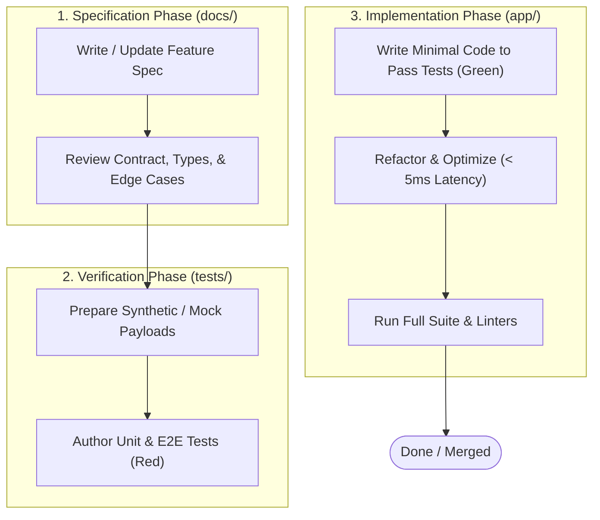

# Spec-Driven Development (SDD) Guide

## 1. What is Spec-Driven Development?

**Spec-Driven Development (SDD)** is an engineering discipline where **specifications and documentation act as the executable contract of intent**. In OryxGate, code is never written based on intuition or inline improvisation. Every capability, schema change, and algorithmic rule begins its life as written documentation.



---

## 2. Why SDD is Mandatory for OryxGate

1. **Fragile Upstream Fusion:**
   Combining Infinite Flight v3 (persistent schedules/slots) and v2 (ephemeral multiplayer positions) relies on heuristic matching (callsigns, flight phases, corridor alignment, breadcrumbs). Without clear specifications, subtle algorithmic bugs quickly creep in and break both the Discord bot and WebApp.
2. **Multiple Downstream Consumers:**
   OryxGate feeds both a Discord bot (chat embeds, fast slash commands, alerts) and an interactive web application (real-time radar, flight tracking). If an endpoint changes unexpectedly, downstream services crash or show corrupt telemetry.
3. **Strict Upstream Rate Limits:**
   Infinite Flight enforces strict polling minimums. If an engineer forgets a cache TTL or introduces an un-cached path, Infinite Flight's servers will rate limit or ban the application. Specifications declare mandatory caching rules upfront.

---

## 3. The Three-Phase Workflow

### Phase 1: Specification (`/docs/`)
Before touching any Python file under `app/`:
- **Define Purpose & Scope:** What problem does this solve?
- **Define Interfaces:** HTTP routes, query parameters, headers, payload schemas, and response formats.
- **Define Domain Models:** Invariant rules, default values, and nullable fields.
- **Define Error Scenarios:** Status codes, error payloads, and failure fallbacks (e.g., stale cache return on upstream 504).
- **Define Caching & Performance:** TTLs, cache key structure, lock requirements.

### Phase 2: Tests First (`/tests/`)
Once the specification is in place, write automated tests asserting the exact contract:
- **Unit Tests (`tests/unit/`):** Test domain logic in complete isolation (e.g., callsign tokenization, corridor scoring, TOD hold detection).
- **Integration Tests (`tests/integration/`):** Test upstream client wrappers with mocked responses (e.g. using `respx` or `aioresponses`).
- **E2E Route Tests (`tests/e2e/`):** Test FastAPI endpoints using `httpx.AsyncClient` or FastAPI's `TestClient` to verify auth checks, response payloads, and status codes.
- **Run the tests:** Confirm that new tests fail or error as expected.

### Phase 3: Implementation (`/app/`)
Write the code to make the tests pass:
- Adhere strictly to the types and behaviors defined in the spec.
- Avoid scope creep: only write what is required to satisfy the tests.
- Verify all tests pass (`pytest`).
- Check code style and typing (`ruff check .`, `mypy app/`).

---

## 4. Feature Specification Template

When authoring a new feature or endpoint, use this template when adding to `/docs/` or creating an RFC:

```markdown
# [RFC-XXX] Feature Name

## 1. Overview
A concise description of the feature, problem solved, and downstream consumers.

## 2. API Contract
- **Method & Path:** `GET /api/v1/...`
- **Authentication:** `Bearer <TOKEN>` (Required / Optional)
- **Rate Limit / Caching:** TTL = X seconds

### Request Parameters / Payload
\`\`\`json
{
  "field": "type"
}
\`\`\`

### Response Payload (200 OK)
\`\`\`json
{
  "status": "success",
  "data": { ... }
}
\`\`\`

### Error Responses
- `401 Unauthorized`: Missing or invalid gateway token.
- `404 Not Found`: Entity not found.
- `502 Bad Gateway`: Upstream service failed and no cached data available.

## 3. Upstream Dependencies
- APIs called (IF v2, IF v3, Crew Center, DB).
- Expected upstream payloads & error mapping.

## 4. Test Strategy
- List of test cases to author in Phase 2 before coding.
```

---

## 5. Definition of Done Checklist

Every change committed to OryxGate must satisfy this checklist:
- [ ] Spec document in `/docs/` updated or created.
- [ ] Automated tests written in `/tests/` covering happy path and edge cases.
- [ ] Implementation code written in `/app/` satisfying the tests.
- [ ] No regression across existing test suite (`pytest -v`).
- [ ] Static typing and linting clean (`ruff`, `mypy`).
- [ ] Upstream caching TTLs validated against Infinite Flight guidelines.
