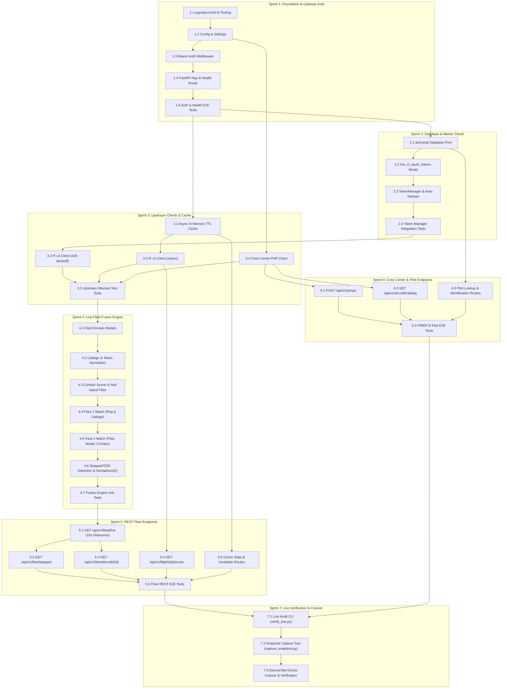

# OryxGate Tasks & Sprints Execution Plan

## 1. Execution Philosophy

This document decomposes the implementation of **OryxGate** into granular, testable, and bite-sized units of work. In strict accordance with **Spec-Driven Development (SDD)**:
- **No implementation code is written without prior tests.**
- Each task defines concrete **Dependencies** and measurable **Acceptance Criteria (AC)**.
- Work is organized into 7 focused sprints progressing from foundational plumbing to live production verification.

---

## 2. Dependency Graph

---

## 3. Sprint Breakdown & Task Details

### 🏃 Sprint 1: Foundation, Settings, & Gateway Authentication
**Goal:** Create a runnable, container-ready FastAPI skeleton with environment validation, security middleware, and verified health endpoints.

#### `TASK-1.1`: Package Management & Tooling Configuration
- **Description:** Initialize `pyproject.toml` with dependencies (`fastapi`, `uvicorn`, `orjson`, `pydantic`, `pydantic-settings`, `aiohttp`, `aiomysql`, `pytest`, `pytest-asyncio`, `respx`, `ruff`, `mypy`). Set Python target $\ge 3.11$.
- **Dependencies:** None.
- **Acceptance Criteria (AC):**
  - `pyproject.toml` installs cleanly in a virtual environment.
  - `pytest`, `ruff check .`, and `mypy` execute without syntax or dependency errors.

#### `TASK-1.2`: Environment Configuration Schema (`app/config.py`)
- **Description:** Implement `Settings` using `pydantic-settings`. Define settings for `GATEWAY_API_TOKENS`, `ADMIN_API_TOKENS`, `IF_API_KEY`, `IF_ORGANIZATION_ID`, `CC_API_KEY`, `CC_API_BASE_URL`, `DB_HOST`, `DB_USER`, `DB_PASSWORD`, `DB_NAME`.
- **Dependencies:** `TASK-1.1`.
- **Acceptance Criteria (AC):**
  - Settings load correctly from `.env` or system environment.
  - Missing mandatory settings raise descriptive validation errors on startup.
  - Secret fields are masked in string representations.

#### `TASK-1.3`: Gateway Bearer Authentication Middleware (`app/core/security.py`)
- **Description:** Implement FastAPI dependency `get_current_token` and `require_admin`. Verify incoming `Authorization: Bearer <TOKEN>` against configured tokens using constant-time `secrets.compare_digest`.
- **Dependencies:** `TASK-1.2`.
- **Acceptance Criteria (AC):**
  - Valid token returns caller context with assigned scopes (`read`, `write`, `admin`).
  - Missing header returns `401 Unauthorized`.
  - Invalid token returns `401 Unauthorized` in $< 1\text{ms}$.
  - Non-admin token attempting admin-scoped dependency returns `403 Forbidden`.

#### `TASK-1.4`: FastAPI App Factory & Health Endpoint (`app/main.py`)
- **Description:** Initialize FastAPI application with default `ORJSONResponse`, global exception handlers, and wire up `GET /api/v1/health`.
- **Dependencies:** `TASK-1.3`.
- **Acceptance Criteria (AC):**
  - `GET /api/v1/health` responds with `200 OK`, `status: "healthy"`, and uptime without authentication.
  - Unhandled exceptions return standard JSON error envelopes instead of HTML tracebacks.

#### `TASK-1.5`: Sprint 1 Verification Test Suite (`tests/e2e/test_auth.py`, `test_health.py`)
- **Description:** Author E2E tests using `httpx.AsyncClient` asserting all auth edge cases and health response schemas.
- **Dependencies:** `TASK-1.4`.
- **Acceptance Criteria (AC):**
  - 100% test pass rate across valid, invalid, and missing token scenarios.

---

### 🏃 Sprint 2: Database Layer & Master OAuth Management
**Goal:** Connect to the shared MySQL database and implement self-healing master OAuth token management for Infinite Flight v3.

#### `TASK-2.1`: Asynchronous MySQL Connection Pool (`app/upstream/database.py`)
- **Description:** Implement `DatabaseManager` using `aiomysql.create_pool` with `DictCursor`. Include automatic pool reconnection on `OperationalError`.
- **Dependencies:** `TASK-1.2`.
- **Acceptance Criteria (AC):**
  - Acquires connections from pool, executes parameterized queries, and releases safely.
  - Stale or severed connections reconnect transparently on retry.

#### `TASK-2.2`: OAuth Token Model (`app/models/oauth.py`)
- **Description:** Implement `IFLiveTokensModel` with methods `get_by_pilot_id`, `save_token`, `update_token`, `delete_token` matching the `live_if_oauth_tokens` schema.
- **Dependencies:** `TASK-2.1`.
- **Acceptance Criteria (AC):**
  - Reads and writes `pilot_id = 1` master token with timezone-aware UTC timestamps.

#### `TASK-2.3`: Master OAuth Token Manager & Auto-Refresh (`app/services/token_manager.py`)
- **Description:** Build `TokenManager` to manage the master token (`pilot_id = 1`). Check `expires_at < utcnow() + 60s`, execute `grant_type=refresh_token` against IF Auth v2, and persist refreshed tokens.
- **Dependencies:** `TASK-2.2`.
- **Acceptance Criteria (AC):**
  - Unexpired token returns stored `access_token` immediately.
  - Expiring token triggers refresh call and updates MySQL atomically.
  - Invalid refresh token raises descriptive `IFLiveAuthError`.

#### `TASK-2.4`: Database & Token Manager Integration Tests (`tests/integration/test_token_manager.py`)
- **Description:** Mock IF Auth v2 `/connect/token` responses with `respx` and test auto-refresh, expiration calculation, and database synchronization.
- **Dependencies:** `TASK-2.3`.
- **Acceptance Criteria (AC):**
  - Automated tests verify token lifecycle transitions (valid $\rightarrow$ near-expiry $\rightarrow$ refreshed).

---

### 🏃 Sprint 3: Upstream Clients & In-Memory Caching Core
**Goal:** Build resilient async client wrappers for IF v2, IF v3, and Crew Center, shielded by an atomic in-memory TTL cache.

#### `TASK-3.1`: Async In-Memory Cache with Locking (`app/core/cache.py`)
- **Description:** Implement an async in-memory cache supporting key-level TTLs and `asyncio.Lock` to eliminate thundering herds on cache misses.
- **Dependencies:** `TASK-1.1`.
- **Acceptance Criteria (AC):**
  - Unexpired items return in $< 1\text{ms}$.
  - Expired items trigger fetcher under lock; concurrent callers await the same refreshed result.
  - Thread-safe stats tracking (hits, misses, hit ratio).

#### `TASK-3.2`: Infinite Flight v3 Client with Rate-Limit Backoff (`app/upstream/if_v3_client.py`)
- **Description:** Implement `IFLiveClient` for IF v3. Wire with `TokenManager`. Implement 429 backoff parsing `(\d+)\s*second` with exponential backoff and max 3 retries.
- **Dependencies:** `TASK-2.3`.
- **Acceptance Criteria (AC):**
  - Supports `list_organization_aircraft`, `get_aircraft_position`, `list_organization_schedules`.
  - 429 response pauses execution for parsed wait time and successfully retries.

#### `TASK-3.3`: High-Throughput Infinite Flight v2 Client (`app/upstream/if_v2_client.py`)
- **Description:** Implement `InfiniteFlightAPIManager` for public v2 endpoints (`/sessions`, `/flights/{sessionId}`, `/flight/{flightId}/route`). Use `orjson.loads()` for payload deserialization.
- **Dependencies:** `TASK-1.2`.
- **Acceptance Criteria (AC):**
  - 1,500+ flight JSON payload deserializes in $< 5\text{ms}$.
  - Automatic `aiohttp.ClientSession` recreation on connector errors.

#### `TASK-3.4`: Crew Center PHP API Client (`app/upstream/crew_center.py`)
- **Description:** Implement `CrewCenterAPIManager` with `submit_pirep` and `fetch_all_aircraft`.
- **Dependencies:** `TASK-1.2`.
- **Acceptance Criteria (AC):**
  - Formats POST payload correctly for PHP backend.
  - Maps ICAO/names to numeric aircraft IDs.

#### `TASK-3.5`: Upstream Clients Integration Tests (`tests/integration/test_upstream_clients.py`)
- **Description:** Comprehensive mock tests for all upstream clients asserting payload mapping, error mapping, and retry loops.
- **Dependencies:** `TASK-3.2`, `TASK-3.3`, `TASK-3.4`.
- **Acceptance Criteria (AC):**
  - All upstream client mock tests pass with 100% assertions green.

---

### 🏃 Sprint 4: Live Fleet Fusion Engine Core
**Goal:** Migrate, harden, and benchmark the state fusion engine, TOD detection, and corridor scoring heuristics.

#### `TASK-4.1`: Fleet Domain Models (`app/models/fleet.py`)
- **Description:** Define Pydantic v2 schemas: `LiveAircraftState`, `LiveFleetSnapshot`, `AircraftTelemetry`, `ScheduleMetadata`, `PilotMetadata`.
- **Dependencies:** `TASK-1.1`.
- **Acceptance Criteria (AC):**
  - Fast serialization and strict typing for all consolidated fields.

#### `TASK-4.2`: Normalization & Callsign Tokenizer (`app/services/callsign_normalizer.py`)
- **Description:** Extract `clean_callsign_tokens`: strip suffixes (`HISTORIC`, `CARGO`, etc.), remove spaces/hyphens, expand IATA $\leftrightarrow$ ICAO (`QR` $\leftrightarrow$ `QTR`).
- **Dependencies:** `TASK-4.1`.
- **Acceptance Criteria (AC):**
  - Unit tests prove `"QR 843 HISTORIC"` yields `{"QR843", "QTR843"}`.

#### `TASK-4.3`: Great Circle & Corridor Scorer with Null Island Filter (`app/services/corridor_scorer.py`)
- **Description:** Implement Haversine NM distance, initial bearing, bearing difference, and route corridor excess scoring. Rejects coordinates where `abs(lat) < 0.001` and `abs(lon) < 0.001`.
- **Dependencies:** `TASK-4.1`.
- **Acceptance Criteria (AC):**
  - Null Island coordinates immediately return 0.0 score without skewing distance.
  - Aligned flights along route corridor receive $+200$ bonus; flights $>500\text{ NM}$ off receive $-250$ penalty.

#### `TASK-4.4`: Multi-Pass Association: Pass 1 (`app/services/fleet_fusion.py`)
- **Description:** Implement Pass 1: exact airframe registration matching and active schedule callsign token matching against v2 candidate flights.
- **Dependencies:** `TASK-4.2`.
- **Acceptance Criteria (AC):**
  - Claimed v2 flight IDs are uniquely assigned and never double-allocated.

#### `TASK-4.5`: Multi-Pass Association: Pass 2 (`app/services/fleet_fusion.py`)
- **Description:** Implement Pass 2: scoring unclaimed flights using Pilot User ID, aircraft model/livery match, airborne/ground match, and corridor score.
- **Dependencies:** `TASK-4.3`, `TASK-4.4`.
- **Acceptance Criteria (AC):**
  - Correctly associates flights when pilots use personal callsigns.

#### `TASK-4.6`: Stopped at TOD Detection & Throttling (`app/services/fleet_fusion.py`)
- **Description:** Detect aircraft airborne in v3 but absent in v2 multiplayer. Throttle breadcrumb queries (`/flight/{id}/route`) via `asyncio.Semaphore(2)`. Extract final coordinates, set `speed = 0.0`, `stopped_at_tod = True`, calculate elapsed time.
- **Dependencies:** `TASK-4.5`, `TASK-3.3`.
- **Acceptance Criteria (AC):**
  - Concurrent breadcrumb queries never exceed 2.
  - Final non-zero breadcrumb point accurately populates `latitude`, `longitude`, and `stopped_since`.

#### `TASK-4.7`: Fusion Engine Unit Test Suite (`tests/unit/test_fleet_fusion.py`)
- **Description:** Author comprehensive unit tests covering standard flights, TOD hold detection, non-standard callsigns, and Null Island rejection.
- **Dependencies:** `TASK-4.6`.
- **Acceptance Criteria (AC):**
  - 100% test pass rate across synthetic fleet scenarios.
  - Full fusion pass benchmarks under $20\text{ms}$ for 50 aircraft.

---

### 🏃 Sprint 5: REST Fleet Endpoints & Caching Guardrails
**Goal:** Expose clean, domain-specific endpoints with admin debounce protections.

#### `TASK-5.1`: Consolidated Live Fleet Endpoint (`GET /api/v1/fleet/live`)
- **Description:** Implement route handler. Check snapshot cache. If `force_refresh=true`, require `admin` scope and enforce global 15-second debounce window.
- **Dependencies:** `TASK-4.7`, `TASK-3.1`.
- **Acceptance Criteria (AC):**
  - Cached response served in $< 5\text{ms}$.
  - Non-admin passing `force_refresh=true` receives cached data without upstream bypass.
  - Rapid admin requests within 15s receive cached data with `meta.cached: true`.

#### `TASK-5.2`: Stopped Aircraft Endpoint (`GET /api/v1/fleet/stopped`)
- **Description:** Implement route returning only aircraft where `is_stopped == True` with human-readable duration strings.
- **Dependencies:** `TASK-5.1`.
- **Acceptance Criteria (AC):**
  - Filters parked and cruising aircraft out of payload.

#### `TASK-5.3`: Aircraft Detail Endpoint (`GET /api/v1/fleet/aircraft/{registration_or_id}`)
- **Description:** Implement single-aircraft lookup by case-insensitive registration or UUID.
- **Dependencies:** `TASK-5.1`.
- **Acceptance Criteria (AC):**
  - Matches `A7-APC` and `A7APC`.
  - Non-existent aircraft returns standard `404 Not Found` JSON envelope.

#### `TASK-5.4`: Flight Route Breadcrumbs Endpoint (`GET /api/v1/flights/{flight_id}/route`)
- **Description:** Implement proxy route to fetch and cache (TTL 60s) breadcrumbs for a specific flight.
- **Dependencies:** `TASK-3.3`, `TASK-3.1`.
- **Acceptance Criteria (AC):**
  - Serves route breadcrumb points from cache when queried repeatedly within 60s.

#### `TASK-5.5`: Cache Management Routes (`GET /api/v1/cache/stats`, `POST /api/v1/cache/invalidate`)
- **Description:** Implement metrics inspection and admin cache eviction.
- **Dependencies:** `TASK-3.1`, `TASK-1.3`.
- **Acceptance Criteria (AC):**
  - Stats display hits, misses, and hit ratio accurately.
  - Invalidate requires `admin` scope and forces next read to re-poll upstream.

#### `TASK-5.6`: Fleet REST API E2E Tests (`tests/e2e/test_fleet_api.py`)
- **Description:** Full endpoint test suite asserting status codes, envelopes, and debounce behavior.
- **Dependencies:** `TASK-5.1` through `TASK-5.5`.
- **Acceptance Criteria (AC):**
  - All E2E route tests pass cleanly.

---

### 🏃 Sprint 6: Crew Center & Pilot Verification Endpoints
**Goal:** Wrap legacy PHP API and database queries into standardized REST endpoints.

#### `TASK-6.1`: PIREP Submission Endpoint (`POST /api/v1/pireps`)
- **Description:** Implement route validating request body with Pydantic and delegating to `CrewCenterAPIManager`.
- **Dependencies:** `TASK-3.4`, `TASK-1.3`.
- **Acceptance Criteria (AC):**
  - Valid payload submits to Crew Center and returns `200 OK` with PIREP ID.
  - Invalid payload returns `422 Unprocessable Entity` with field error details.

#### `TASK-6.2`: Aircraft Catalog Endpoint (`GET /api/v1/aircraft/catalog`)
- **Description:** Implement route returning cached mapping of aircraft names to database IDs.
- **Dependencies:** `TASK-3.4`.
- **Acceptance Criteria (AC):**
  - Returns JSON dictionary mapping (e.g. `{"A359": 14}`).

#### `TASK-6.3`: Pilot Lookup & Identification Routes (`GET /api/v1/pilots/*`, `POST /api/v1/pilots/identify`)
- **Description:** Implement pilot retrieval by callsign, Discord ID, or multi-method nickname matching.
- **Dependencies:** `TASK-2.1`.
- **Acceptance Criteria (AC):**
  - Correctly identifies active pilots and returns transfer hours, status, and linked accounts.

#### `TASK-6.4`: PIREP & Pilot Routes E2E Tests (`tests/e2e/test_pireps_pilots.py`)
- **Description:** End-to-end tests mocking Crew Center and database queries.
- **Dependencies:** `TASK-6.1` through `TASK-6.3`.
- **Acceptance Criteria (AC):**
  - All E2E tests pass cleanly.

---

### 🏃 Sprint 7: Live Verification CLI & Downstream Bot Cutover
**Goal:** Build operational verification tools and connect the Oryxie Discord Bot.

#### `TASK-7.1`: Live Audit & Diff CLI Tool (`scripts/verify_live.py`)
- **Description:** Implement standalone CLI tool comparing raw v3, `live.infiniteflight.com`, and OryxGate consolidated state side-by-side.
- **Dependencies:** `TASK-5.1`.
- **Acceptance Criteria (AC):**
  - Prints terminal comparison table highlighting coordinate and speed deltas.

#### `TASK-7.2`: Telemetry Snapshot Capture Tool (`scripts/capture_snapshot.py`)
- **Description:** Implement capture utility to dump active session payloads into `tests/fixtures/real_world_snapshots/`.
- **Dependencies:** `TASK-3.2`, `TASK-3.3`.
- **Acceptance Criteria (AC):**
  - Dumps valid JSON fixtures usable for automated regression testing.

#### `TASK-7.3`: Oryxie Discord Bot Integration & Cutover
- **Description:** Update Oryxie Discord bot HTTP client to query OryxGate `/api/v1/fleet/*` instead of direct IF APIs.
- **Dependencies:** `TASK-5.6`, `TASK-7.1`.
- **Acceptance Criteria (AC):**
  - Discord `/fleet` and `/stopped` slash commands render instantaneously ($< 100\text{ms}$).
  - Upstream IF API 429 rate limits drop to zero.
