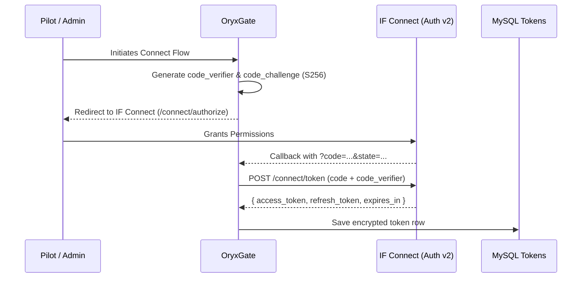

# Upstream Integrations & Data Contracts

OryxGate acts as a secure intermediary and abstraction layer over four upstream systems. This document outlines the protocols, authentication mechanisms, and data contracts for each upstream service.

---

## 1. Infinite Flight Live API v3 & Auth v2

### Overview
- **Auth URL:** `https://api.infiniteflight.com/auth/v2`
- **Base API URL:** `https://api.infiniteflight.com/public/v3`
- **Protocol:** HTTPS, JSON
- **Authentication:** OAuth 2.0 PKCE Authorization Code Grant + Refresh Token rotation.

### Token Flow

### Master OAuth Token Management (`live_if_oauth_tokens`)
Infinite Flight v3 access is anchored to the organization owner/executive account (stored under `pilot_id = 1` in `live_if_oauth_tokens`), which holds maximum permissions across the organization (read roster, view positions, manage schedules, update flight plans).

- **Token Loading:** OryxGate loads the master token on startup or request via `IFLiveTokensModel.get_by_pilot_id(1)`.
- **Auto-Refresh Protocol:** Before issuing any request using `IFLiveClient`, OryxGate checks the token expiration:
  - If `expires_at < utcnow() + 60s`, OryxGate automatically calls `/connect/token` with `grant_type=refresh_token`.
  - It saves the updated access token, refresh token, and new expiration date back into `live_if_oauth_tokens`.
  - If the refresh token is revoked or invalid (`invalid_grant`), OryxGate logs an alert that re-authorization is required.
- **Decoupled Downstream:** Downstream consumers (Discord bot, WebApp) never touch IF OAuth tokens or need individual pilot OAuth sessions; they interact exclusively through OryxGate's API.

#### `IFLiveTokensModel` Specification (`app/models/oauth.py`)
Provides persistence and retrieval operations on the `live_if_oauth_tokens` MySQL table:

- **Methods:**
  - `get_by_pilot_id(pilot_id: int) -> dict[str, Any] | None`: Retrieves token row by pilot ID. Returned dictionary timestamps (`expires_at`, `created_at`, `updated_at`) are guaranteed to be timezone-aware UTC `datetime` objects.
  - `get_by_if_user_id(if_user_id: str) -> dict[str, Any] | None`: Retrieves token row by Infinite Flight user UUID.
  - `get_pending_by_state(state: str) -> dict[str, Any] | None`: Retrieves pending PKCE authorization row matching `pending:<state>:%`.
  - `save_token(pilot_id: int, access_token: str, refresh_token: str, expires_at: datetime | str | int | float, scope: str, if_user_id: str | None = None) -> int`: Upserts token record using `INSERT ... ON DUPLICATE KEY UPDATE`. Accepts timezone-aware `datetime`, naive `datetime` (assumed UTC), ISO 8601 string, or unix timestamp, normalizing and persisting in UTC.
  - `update_token(pilot_id: int, access_token: str, refresh_token: str, expires_at: datetime | str | int | float, scope: str) -> int`: Updates access token, refresh token, UTC expiration date, and scope for a given `pilot_id`.
  - `update_if_user_id(pilot_id: int, if_user_id: str) -> int`: Updates the Infinite Flight user UUID for a given `pilot_id`.
  - `set_pending(pilot_id: int, state: str, verifier: str) -> int`: Inserts or updates a pending PKCE state record formatted as `pending:<state>:<verifier>`.
  - `delete_token(pilot_id: int) -> int`: Deletes the token row for a given `pilot_id`.
- **Domain Schema (`OAuthTokenRecord`):**
  Pydantic model representing a token record with fields `pilot_id`, `access_token`, `refresh_token`, `expires_at` (timezone-aware UTC), `scope`, `if_user_id`, `created_at`, and `updated_at`. Includes `is_expired(buffer_seconds=60)` and `is_pending` helper properties.

### Rate Limit Handling (429)
Infinite Flight v3 returns a `429` status when throttled. The response body contains a wait interval string (e.g. `"Please retry after 5 seconds"`).
- OryxGate parses the required wait duration using regex `(\d+)\s*second`.
- It executes an asynchronous backoff (`asyncio.sleep(retry_seconds)`) and retries up to 3 times before raising `IFLiveRateLimitError`.

---

## 2. Infinite Flight Live API v2

### Overview
- **Base URL:** `https://api.infiniteflight.com/public/v2`
- **Protocol:** HTTPS, JSON
- **Serialization / Parser:** `orjson` for sub-3ms parsing of 1,500+ flight JSON arrays
- **Authentication:** Query parameter `?apikey=<IF_API_KEY>`

### Polling Endpoints & Caching Rules
- `GET /sessions`:
  Returns multiplayer sessions (Expert, Training, Casual). Cached for **600s** (10m).
- `GET /flights/{sessionId}`:
  Returns all active flights in the multiplayer session. Cached for **20s**.
- `GET /flight/{flightId}/route`:
  Returns chronological breadcrumb points (`[ { latitude, longitude, altitude, groundSpeed, track, date } ]`). Cached for **60s**.
- `GET /sessions/{sessionId}/flights/{flightId}/flightplan`:
  Returns filed flight plan waypoints.
- `GET /users/{userId}/flights`:
  Returns user flight history for resolving recent flight IDs.

---

## 3. Crew Center (CC) PHP API

### Overview
- **Base URL:** Configured via `CC_API_BASE_URL`
- **Protocol:** HTTPS
- **Authentication:** Query parameter `?apikey=<CC_API_KEY>`

### Endpoints
#### `POST /pireps`
Submits a pilot report for verification and hour logging.
- **Form Data Fields:**
  - `pilotid` (integer): Pilot database ID.
  - `flightnum` (string): Flight number without airline prefix (e.g. `"1234"`).
  - `departure` (string): 4-letter ICAO code.
  - `arrival` (string): 4-letter ICAO code.
  - `flighttime` (string): Duration formatted as `HH:MM`.
  - `date` (string): `YYYY-MM-DD`.
  - `aircraft` (integer): Internal aircraft ID.
  - `fuel` (float): Fuel consumed in kg/lbs.
  - `multi` (string, optional): Event multiplier name.

#### `GET /aircraft`
Returns the active aircraft catalog for the virtual airline, mapping human-readable names and ICAO types to numeric database IDs.

---

## 4. MySQL Database (`aiomysql`)

### Overview
OryxGate communicates directly with the shared MySQL database for pilot verification, token persistence, and analytics. Connection pooling and query execution are managed by `DatabaseManager` in `app/upstream/database.py`.

### Connection Management & Specification (`DatabaseManager`)
- **Connection Pool:** Uses `aiomysql.create_pool` with `minsize=1`, `maxsize=10`, `autocommit=True`, and `charset="utf8mb4"`.
- **Cursor Type:** `aiomysql.DictCursor` by default, ensuring all query rows return as `dict[str, Any]` mappings.
- **Configuration:** Reads credentials from `Settings` (`DB_HOST`, `DB_PORT`, `DB_USER`, `DB_PASSWORD`, `DB_NAME`).
- **Lifecycle Methods:**
  - `connect() -> None`: Initializes the connection pool if not already established. Thread-safe/async-safe with `asyncio.Lock`.
  - `close() -> None`: Gracefully drains and closes the connection pool via `pool.close()` and `await pool.wait_closed()`.
- **Query Execution API:**
  - `acquire() -> AsyncIterator[aiomysql.Connection]`: Context manager acquiring a connection from the pool and releasing it safely in a `finally` block.
  - `fetch_one(query: str, params: tuple | list | dict | None = None) -> dict[str, Any] | None`: Acquires a connection, executes the parameterized read query using `DictCursor`, and returns a single dictionary or `None`. Retries once transparently on `OperationalError`.
  - `fetch_all(query: str, params: tuple | list | dict | None = None) -> list[dict[str, Any]]`: Acquires a connection, executes the parameterized read query using `DictCursor`, and returns a list of dictionaries. Retries once transparently on `OperationalError`.
  - `execute(query: str, params: tuple | list | dict | None = None) -> int`: Acquires a connection, executes a mutation statement (INSERT, UPDATE, DELETE), and returns `cursor.rowcount`. If an `OperationalError` occurs, the pool is re-established for future queries, but the statement itself is **never silently retried** to avoid duplicate write side-effects under `autocommit=True`; the error is surfaced to the caller.
  - `ping() -> bool`: Executes `SELECT 1` to verify database reachability and liveness; returns `True` if successful, `False` on failure.
- **Self-Healing Reconnection Strategy & Stampede Protection:**
  - **Connection Staleness Filtering (`is_disconnect_error`):** Pool teardown and rebuild are restricted strictly to actual network connection severing and server-gone error codes (`2002`, `2003`, `2005`, `2006`, `2013`, `2055`). Server-side contention and concurrency `OperationalError` codes (e.g. `1213` Deadlock, `1205` Lock wait timeout, `1040` Too many connections) **never** trigger pool teardown or rebuilding, and are propagated directly to the caller.
  - **Pool Generation Marker:** The manager tracks a monotonic `_pool_generation` counter. Callers capturing an `OperationalError` pass their observed `failed_generation` to `_reconnect()`. If `_pool_generation > failed_generation` upon acquiring `_lock`, the rebuild is bypassed as a no-op because another concurrent caller has already renewed the pool.
  - **Read-Path Transparent Retry:** When executing read queries (`fetch_one`, `fetch_all`, `ping`), disconnect `OperationalError` codes trigger `_reconnect(failed_generation)` and transparently retry the query up to 1 time.
  - **Write-Path Safety:** For disconnect errors during `execute()`, `_reconnect(failed_generation)` is triggered to ensure subsequent operations acquire a healthy pool, but surfaces the underlying `OperationalError` without re-executing the statement to prevent duplicate mutation.
  - **Non-Operational Failures:** Syntax, constraint, or table errors (`ProgrammingError`, `IntegrityError`) are never retried and bubble up immediately.

### Key Table Schemas

#### Table: `pilots`
| Column | Type | Description |
| :--- | :--- | :--- |
| `id` | `int (PK)` | Internal pilot ID |
| `callsign` | `varchar(120)`| VA callsign (e.g. `QRV101`) |
| `name` | `text` | Full name |
| `ifc` | `text` | Infinite Flight Community profile link |
| `ifuserid` | `varchar(36)` | IF public UUID |
| `discordid`| `varchar(30)` | Discord snowflake ID |
| `transhours`| `int` | Historical transfer hours in seconds |
| `status` | `int` | 1 = Active, 0 = Inactive |

#### Table: `live_if_oauth_tokens`
Stores the OAuth 2.0 PKCE tokens used to communicate with Infinite Flight v3. The primary administrative account is keyed by `pilot_id = 1`.

| Column | Type | Description |
| :--- | :--- | :--- |
| `pilot_id` | `int (PK)` | Internal pilot database ID (e.g. `1` for Owner/Admin) |
| `access_token` | `text` | Current IF v3 Bearer access token (or `pending:<state>:<verifier>`) |
| `refresh_token`| `text` | OAuth2 offline refresh token |
| `expires_at` | `datetime` | UTC expiration timestamp of the access token |
| `scope` | `text` | Authorized scopes string |
| `if_user_id` | `varchar(36)` | Infinite Flight user UUID |
| `created_at` | `datetime` | Token creation timestamp |
| `updated_at` | `datetime` | Last token refresh / update timestamp |

#### Table: `pireps`
| Column | Type | Description |
| :--- | :--- | :--- |
| `id` | `int (PK)` | PIREP ID |
| `flightnum`| `text` | Callsign / flight number |
| `departure`| `varchar(4)` | Departure ICAO |
| `arrival` | `varchar(4)` | Arrival ICAO |
| `flighttime`| `int` | Flight duration in seconds |
| `pilotid` | `int (FK)` | Pilot ID |
| `status` | `int` | 0 = Pending, 1 = Accepted, 2 = Rejected |
| `date` | `date` | Flight completion date |
| `fuelused` | `int` | Fuel used |
