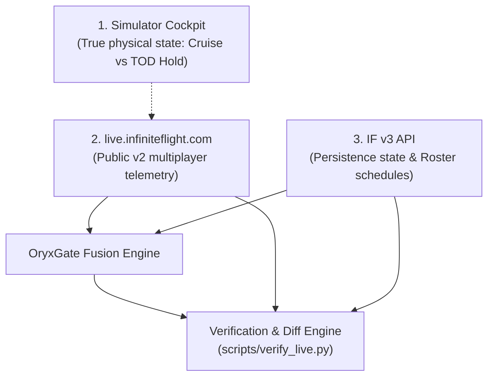

# Live Data Verification Guide

## 1. Overview & Verification Strategy

The core value proposition of **OryxGate** is its ability to bridge discrepancies between Infinite Flight's internal persistence layer (v3) and real-time multiplayer telemetry (v2). 

To ensure that the state emitted by OryxGate reflects reality, we verify it against three sources of ground truth:
1. **The Game Client (Simulator / Cockpit):** What the pilot actually sees on their flight deck (instruments, autopilot AP+ mode, simulator pause state).
2. **`live.infiniteflight.com` (Public Live Map):** The public multiplayer radar display showing live session traffic, flight paths, and reported ground speed.
3. **Infinite Flight v3 API:** The organization's internal aircraft roster, schedule slots, and persistence data.



---

## 2. Deep-Link Inspection via `live.infiniteflight.com`

Infinite Flight's live radar supports direct inspection of any active multiplayer flight via its unique `flightId` UUID:

```
https://live.infiniteflight.com/?flightId=<v2_flight_id>
```

When an airframe is actively flying in multiplayer, OryxGate captures its `v2_flight_id` and exposes it in the API payload under `multiplayer.flight_id`.

### Cross-Checking Protocol:
When verifying an active aircraft:
1. Retrieve the aircraft state from `GET /api/v1/fleet/live`.
2. Extract the `multiplayer.flight_id` field.
3. Open `https://live.infiniteflight.com/?flightId=<v2_flight_id>` in a browser.
4. Verify the following parameters:
   - **Position:** Latitude and longitude must align with the aircraft icon on the live map ($\le 0.05\text{ NM}$ difference).
   - **Ground Speed & Altitude:** Ground speed and altitude must match what `live.infiniteflight.com` displays.
   - **Heading / Track:** Heading angle must align with the directional chevron on the live map.

---

## 3. The Three In-Flight Test Scenarios

To prove that OryxGate correctly handles real-world aviation operations, tests must be run across three distinct simulator scenarios:

### Scenario 1: Normal Active Cruise
- **Simulation Action:** Pilot spawns at origin (e.g. OTHH), files a flight plan, takes off, and climbs to cruising altitude (e.g. FL380) with a standard callsign (`QTR101`).
- **Expected Verification Results:**
  - `live.infiniteflight.com`: Shows the flight moving with ground speed $> 400\text{ kts}$.
  - `GET /api/v1/fleet/live`: Reports `state: "IN_FLIGHT"`, `is_actively_flying: true`, `is_stopped: false`.
  - Coordinates match the cockpit navigation display and the live map.

### Scenario 2: Top of Descent (TOD) / AP+ Hold Incident
- **Simulation Action:** 
  The aircraft reaches Top of Descent (TOD) while AP+ is engaged, or the pilot pauses/exits the simulator while airborne. The multiplayer connection closes.
- **The Ground Truth Contradiction:**
  - `live.infiniteflight.com`: The aircraft **vanishes** from the live map because its multiplayer session disconnected.
  - Raw v3 API: Falsely continues to report `state: 2 (IN_FLIGHT)` and cruise speed `480 kts` indefinitely.
- **Expected OryxGate Verification Results:**
  - `GET /api/v1/fleet/stopped`: Returns the aircraft in the stopped list.
  - `is_stopped`: Evaluates to `true`.
  - `stopped_at_tod`: Evaluates to `true`.
  - `telemetry.ground_speed`: Set to `0.0`.
  - `telemetry.latitude` & `telemetry.longitude`: Resolved to the exact final coordinates from the route breadcrumb trail (`v2 /flight/{id}/route`), marking where AP+ engaged the hold.
  - `stopped_display_time`: Accurately displays elapsed time (e.g. `"15m ago"`).

### Scenario 3: Non-Matching Callsign Flight
- **Simulation Action:** 
  A registered pilot flies organization airframe `A7-BCB` (scheduled as `QR843`), but logs into the multiplayer server using their personal callsign or IFC username.
- **Expected OryxGate Verification Results:**
  - Pass 1 (Callsign match) fails to match.
  - Pass 2 (Pilot User ID + Aircraft Model + Corridor Alignment) detects the pilot's IFC user ID, matches the aircraft livery/model ID, scores the origin $\rightarrow$ destination corridor alignment, and correctly binds the flight to `A7-BCB`.

---

## 4. Verification CLI Tool (`scripts/verify_live.py`)

A standalone CLI tool is provided to audit and diff OryxGate's consolidated state against raw upstream outputs in real time:

```powershell
python -m scripts.verify_live --reg A7-APA
```

### Sample Audit Output:
```text
================================================================================
ORYXGATE LIVE VERIFICATION AUDIT
Target Airframe: A7-APA | Livery: A350-900 (Qatar Airways)
================================================================================
Metric                  IF v3 Persistence   live.infiniteflight  OryxGate Fused
--------------------------------------------------------------------------------
State Classification:   IN_FLIGHT           ACTIVE_SESSION       IN_FLIGHT
Callsign:               N/A                 QTR101               QTR101
Latitude, Longitude:    25.2609, 51.5651    25.2612, 51.5654     25.2612, 51.5654
Altitude (ft):          38,000              38,000               38,000
Ground Speed (kts):     472                 473                  473
Track / Heading:        135°                135°                 135°
Last Pilot:             Ayush (UID: 2d65)   Ayush (UID: 2d65)    Ayush
--------------------------------------------------------------------------------
Delta Analysis:
  • Position Discrepancy: 0.02 NM (PASS: within <= 0.05 NM threshold)
  • Speed Discrepancy:    1 knot  (PASS: within <= 5 kts threshold)
  • Live Radar Link:      https://live.infiniteflight.com/?flightId=890d7973-c603...
================================================================================
```

---

## 5. Telemetry Snapshot Capture & Regression Testing

To ensure heuristic changes don't introduce regressions, real-world session payloads are captured and replayed deterministically in automated tests.

### Snapshot Workflow:
1. **Capture:** When an event or multi-pilot flight occurs, run the capture utility:
   ```powershell
   python -m scripts.capture_snapshot --output tests/fixtures/real_world_snapshots/2026_11_event.json
   ```
   This saves raw responses from:
   - `v3 /live/organizations/{org_id}/aircraft`
   - `v3 /live/aircraft/{id}/position`
   - `v2 /sessions`
   - `v2 /flights/{session_id}`
   - `v2 /flight/{flight_id}/route`

2. **Replay Assertions:**
   Automated unit tests in `tests/unit/test_fleet_fusion.py` load these snapshots and assert:
   - Cruising aircraft match their exact `live.infiniteflight.com` telemetry.
   - Ground aircraft are never classified as airborne.
   - Stopped aircraft at TOD are identified with zero false positives.
   - Ground speed for stopped aircraft drops cleanly to `0.0`.
